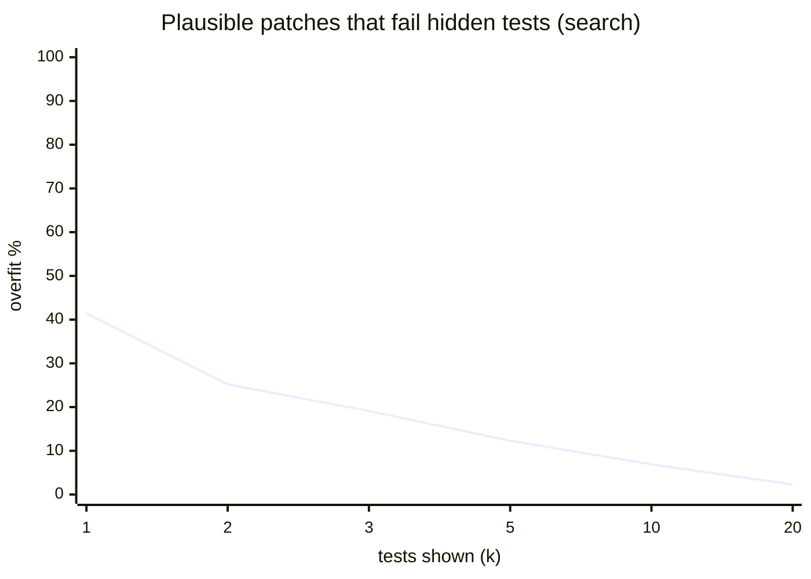

# Results

k = tests shown to the repairer. A patch is *plausible* if it passes those k tests, *correct* if it also passes every hidden test, *overfit* if it does not.

## search

| k | tasks | plausible | correct | overfit (of plausible) |
|--:|--:|--:|--:|--:|
| 1 | 139 | 96% | 56% | 41% |
| 2 | 139 | 94% | 71% | 25% |
| 3 | 139 | 94% | 76% | 19% |
| 5 | 139 | 94% | 82% | 12% |
| 10 | 139 | 94% | 87% | 7% |
| 20 | 139 | 92% | 90% | 2% |

## Overfit rate vs. tests shown

